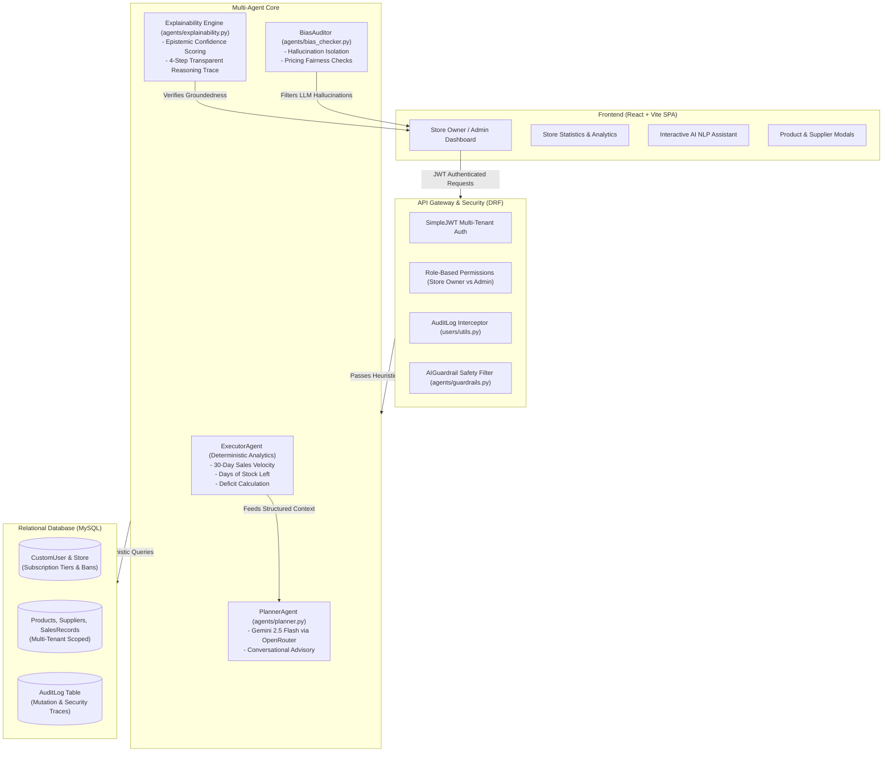

# Agentic Inventory Management System
> **Multi-Agent B2B SaaS Retail Logistics Platform**  
> **Coursework**: IT3041 - Information Retrieval and Web Analytics  
> **Institution**: Sri Lanka Institute of Information Technology (SLIIT)

[](https://www.djangoproject.com/)
[](https://react.dev/)
[](https://openrouter.ai/)
[](https://www.mysql.com/)
[](https://github.com/tharinduudara06/AI-Agentic-Inventory-Management-System)

---

## 📌 Executive Summary

The **Agentic Inventory Management System** is an enterprise-grade multi-agent SaaS platform engineered to automate B2B retail supply chain logistics, inventory replenishment forecasting, and administrative oversight. 

Modern inventory platforms often struggle with the trade-off between generative AI intelligence and deterministic mathematical accuracy. This platform solves this challenge using a **hybridized Multi-Agent architecture**:
* **Deterministic Analytics Engine (`ExecutorAgent`)**: Operates inside the secure database perimeter to perform mathematically verifiable sales velocity calculations, stock depletion forecasting, and anomaly detection.
* **Generative Strategic Planner (`PlannerAgent`)**: Powered by Google Gemini via OpenRouter to synthesize multi-step plain-text business recommendations and conduct interactive conversational inventory queries.
* **Zero-Trust Security & Responsible AI Layer**: Rigorous AI guardrails, explainability confidence intervals, algorithmic bias auditing, multi-tenant IDOR protection, and automated database audit logging.

---

## 👥 Research Team & Individual Contributions

This project was developed by a team of 4 software engineering students for the **IT3041 - Information Retrieval and Web Analytics** module. Each member spearheaded an independent research domain, developed core features, and engineered 15 empirical test scenarios:

| Student Name | Student ID | Research Assessment Domain | Core Features & Architecture | Test Suite |
| :--- | :--- | :--- | :--- | :--- |
| **Wijethunga A.T.U** | `IT 23599222` | **Privacy & Data Leakage Assessment** | Multi-Tenant IDOR isolation, RBAC, Database Audit Logging (`AuditLog`), Stripe subscription tiers, PII filtering | `server/users/test_privacy_security.py` |
| **Alahakoon A.M.I.B** | `IT 23628168` | **Responsible AI & Bias Assessment** | Explainability Engine (`XAI`), Confidence interval scoring, `BiasAuditor` (hallucination & price fairness), `ExecutorAgent` | `server/agents/test_responsible_ai.py` |
| **Abayawardana M.M.C.H** | `IT 23705838` | **Prompt Injection & Jailbreak Analysis** | `AIGuardrail` heuristic regex engine, chat payload interception (SQLi, XSS, eval/exec), Base64 obfuscation defense | `server/agents/test_prompt_injection.py` |
| **Herath H.M.P.P** | `IT 23751514` | **Information Retrieval & Security** | Database aggregations (Valuation, Health metrics), Soft deletion (`is_active`), Foreign key constraints, Inventory CRUD | `server/inventory/test_information_retrieval.py` |

---

## 🏗️ System Architecture



---

## ✨ Key Platform Features

### 1. Deterministic Multi-Agent Logistics
* **30-Day Velocity Tracking**: Calculates daily consumption velocity based on historical sales ledgers.
* **Lead-Time Buffer Analysis**: Predicts stockout dates relative to supplier replenishment lead times.
* **Automated Anomaly Tagging**: Classifies stock into `OPTIMAL`, `URGENT_REORDER`, and `OVERSTOCK`.

### 2. Responsible AI & Explainability (XAI)
* **Epistemic Calibration**: Confidence scores dynamically degrade when empirical parameters (stock, cost, thresholds) are missing or zeroed.
* **4-Step Traceability**: AI output must follow a 4-step transparent reasoning chain (`Data Audit` $\rightarrow$ `Deficit Calculation` $\rightarrow$ `Reorder Recommendation` $\rightarrow$ `Financial Impact`).
* **Bias & Hallucination Auditor**: Cross-validates all LLM recommendations against physical database IDs, stripping non-existent suggestions.

### 3. Enterprise Prompt Injection & Jailbreak Defense
* **Heuristic Regex Shielding**: Blocks directive-cancellation attacks (`Ignore previous instructions`, `DAN mode`).
* **Code Injection Mitigation**: Traps raw SQL injection, DOM-based `<script>` XSS, and Python `eval()` / `exec()` calls in conversational chat.
* **Evasion Resilience**: Detects Base64 encoding obfuscation and XML tag context escapes (`<system_prompt>`).

### 4. Multi-Tenant Data Isolation & SaaS Billing
* **IDOR Resistance**: Strict `IsOwner` queryset filtering ensures Store A cannot access Store B's logistics data.
* **Administrative Governance**: Superusers can review global KPIs, toggle store suspension, and inspect mutation logs.
* **Subscription Tier Gating**: Features and inventory capacity are dynamically enforced across `STARTER` (5 products limit), `PRO`, and `ENTERPRISE` tiers with Stripe payment workflows.

---

## 🧪 Comprehensive Automated Testing (60 Scenarios)

The repository includes **60 automated empirical test scenarios** achieving a **100% test pass rate**:

```bash
cd server
python manage.py test users.test_privacy_security \
                      agents.test_responsible_ai \
                      agents.test_prompt_injection \
                      inventory.test_information_retrieval
```

### Test Suite Breakdown:

#### 1. Privacy & Data Isolation (`users/test_privacy_security.py`)
* `TC-01`: General API Authentication Barrier (401 Unauthorized for anonymous requests).
* `TC-02`: Cryptographically Tampered JWT Token Rejection.
* `TC-03`: Multi-Tenant Object Isolation (Store A cannot view Store B products).
* `TC-04`: Direct IDOR Exploit Prevention (404 Not Found on competitor UUIDs).
* `TC-05`: Suspended Store Access Revocation (Immediate 403 Forbidden).
* `TC-06 - TC-08`: Vertical Privilege Escalation & Subscription Tier Limits enforcement.
* `TC-09`: PII Serialization Governance (Hashed passwords omitted from `/api/users/me/`).
* `TC-10 - TC-15`: Autonomous Database Audit Logging for security and mutation events.

#### 2. Responsible AI & Bias (`agents/test_responsible_ai.py`)
* `TC-01 - TC-03`: Explainability confidence scoring (1.0 on complete datasets, degraded on null data).
* `TC-04`: Parametric Hallucination Detection (Intercepting non-existent product IDs).
* `TC-05`: Capital Requirement Financial Transparency logging.
* `TC-06`: Supplier Demographic Invariance (Zero adverse bias across supplier locales).
* `TC-07 - TC-10`: Zero-Stock, Negative integer, and Zero-cost edge-case stability.
* `TC-11 - TC-15`: Operational math deficit clarity and ethical anti-hoarding refusals.

#### 3. Prompt Injection & Jailbreaks (`agents/test_prompt_injection.py`)
* `TC-01`: Direct Instruction Override (Jailbreak refusal).
* `TC-02`: System Prompt Leakage Extraction block.
* `TC-03`: Role Hijacking & Privilege Escalation (Linux shell impersonation refusal).
* `TC-04`: Safety Rule Bypass Attempt detection.
* `TC-05 - TC-08`: SQLi, XSS, and Python `eval()`/`exec()` code injection interception.
* `TC-09 - TC-11`: Base64 encoding obfuscation and XML tag context escape blocks.
* `TC-12 - TC-15`: Control validation for legitimate retail inquiries.

#### 4. Information Retrieval & DB Integrity (`inventory/test_information_retrieval.py`)
* `TC-01`: Active Retrieval Filtering (Soft-deleted `is_active=False` stock omitted).
* `TC-02 - TC-03`: Database Aggregation Integrity (Total inventory valuation & health thresholds).
* `TC-04`: Cross-Table Foreign Key Execution and relational integrity.
* `TC-05`: Record Durability (HTTP DELETE morphs into soft delete).
* `TC-06 - TC-07`: Search parameter SQLi escaping and defective JSON handling.
* `TC-08 - TC-15`: Logistical transaction binding, array sorting, and pagination.

---

## 📂 Project Structure

```text
├── client/                               # Vite + React Frontend SPA
│   ├── public/                           # Static assets & SVG icons
│   └── src/
│       ├── api/                          # Axios API configuration
│       ├── components/                   # Modal dialogs (AddProduct, EditProduct, UpgradePlan)
│       ├── pages/                        # Views (StoreOwnerDashboard, AdminDashboard, StoreStatistics)
│       └── services/                     # Centralized API service layer
│
├── server/                               # Django REST Framework Backend
│   ├── agents/                           # Multi-Agent Framework
│   │   ├── executor.py                   # Deterministic Analytics Agent
│   │   ├── planner.py                    # Gemini Generative Planner Agent
│   │   ├── explainability.py             # XAI Confidence & Reasoning Engine
│   │   ├── bias_checker.py               # Hallucination & Fairness Auditor
│   │   ├── guardrails.py                 # AIGuardrail Regex Heuristic Filter
│   │   ├── test_prompt_injection.py      # Student 3 Test Suite (15 Tests)
│   │   └── test_responsible_ai.py        # Student 2 Test Suite (15 Tests)
│   │
│   ├── inventory/                        # Logistics & Inventory Management
│   │   ├── models.py                     # Product, Supplier, SalesRecord
│   │   ├── views.py                      # TenantModelViewSet, StoreStatisticsView
│   │   ├── seed_data.py                  # Multi-tenant fixture seeding command
│   │   └── test_information_retrieval.py # Student 4 Test Suite (15 Tests)
│   │
│   ├── users/                            # Authentication, Security & Billing
│   │   ├── models.py                     # CustomUser, Store, AuditLog
│   │   ├── views.py                      # Admin overview, Stripe checkout, Store suspension
│   │   ├── utils.py                      # log_audit_event telemetry helper
│   │   └── test_privacy_security.py      # Student 1 Test Suite (15 Tests)
│   │
│   └── server_core/                      # Project root settings, URLs, ASGI/WSGI
│       ├── settings.py
│       └── urls.py
```

---

## 🚀 Getting Started

### Prerequisites
* **Python**: 3.11+
* **Node.js**: 18+ & npm
* **MySQL**: 8.0+

### 1. Backend Setup (Django)

```bash
# Navigate to backend directory
cd server

# Create and activate virtual environment
python3 -m venv venv
source venv/bin/activate    # On Windows: venv\Scripts\activate

# Install dependencies
pip install -r requirements.txt

# Configure environment variables (.env)
cp .env.example .env
# Update DATABASE credentials and OPENROUTER_API_KEY in .env

# Run database migrations
python manage.py makemigrations
python manage.py migrate

# (Optional) Seed realistic multi-tenant mock data
python manage.py seed_data

# Launch Django development server
python manage.py runserver
```

### 2. Frontend Setup (React)

```bash
# Navigate to frontend directory
cd client

# Install packages
npm install

# Start Vite development server
npm run dev
```

The application will be accessible at `http://localhost:5173/`.

---

## 📜 Standards & Compliance Alignment

* **NIST AI Risk Management Framework (NIST AI RMF 1.0)**:
  * *Govern 1.2 & Measure 2.6*: Demographic invariance in automated supply chain replenishment and anti-hoarding barriers.
* **European Union AI Act (Regulation EU 2024/1689)**:
  * *Article 13*: Technical transparency and explainability confidence scores rendered to human operators.
* **OWASP API Security Top 10 (2023)**:
  * *API1*: Ironclad Object Level Authorization (B2B tenant isolation).
  * *API2 & API10*: Cryptographic JWT lifecycle validation and automated mutation audit logging.
* **OWASP Top 10 for Large Language Models (LLM Apps v1.1)**:
  * *LLM01 & LLM02*: Rigorous prompt injection filtering and sanitization of unstructured model outputs.

---

## 📄 License & Academic Integrity

This project was developed for academic evaluation purposes under the **B.Sc. (Hons) in Information Technology** curriculum at **SLIIT**. All rights reserved © 2026.
